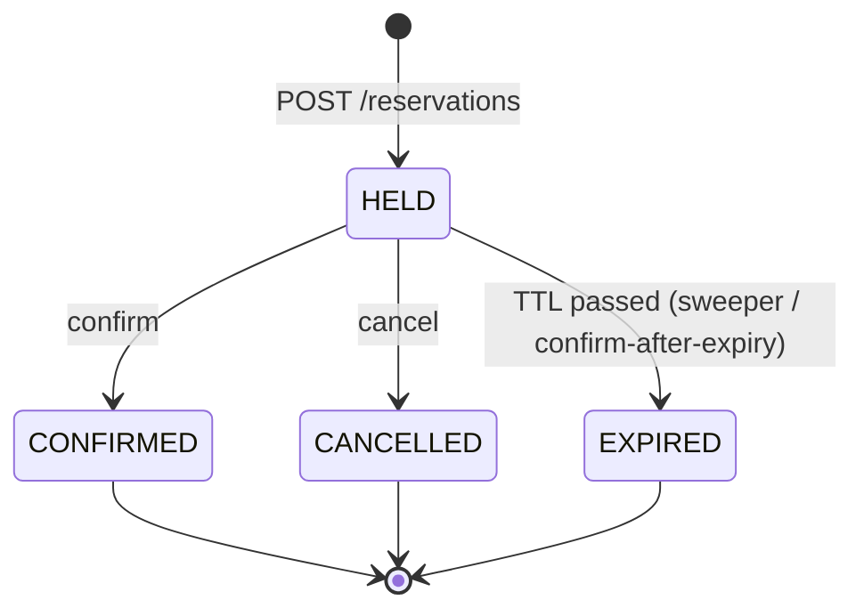
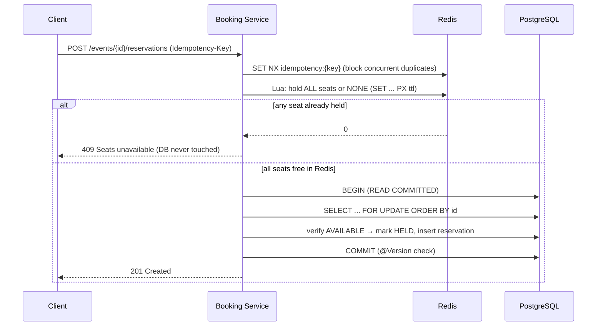

# Event Ticket Booking Service


A seat reservation service built so that **a seat can never be double-booked**, even when many
users click "Book" on the same seat at the same moment.

**Tech:** Java 17 · Spring Boot · Spring Data JPA · PostgreSQL · Redis · Flyway · Docker

---

## How it works

Booking happens in two steps, like on most ticketing sites:

1. **Hold**: the user picks seats and the system holds them for a limited time (10 minutes by default).
2. **Confirm** (after payment) turns the hold into a booking. **Cancel** gives the seats back.
   If the user does neither, the hold **expires** and the seats go back on sale automatically.



## How double booking is prevented

Three layers, each one a backup for the one before it:



| Layer | Mechanism | Purpose |
|---|---|---|
| 1. Redis gate | Atomic Lua script, `SET key reservationId PX ttl` for every seat | Rejects most competing requests early, without touching the database. Holds expire by TTL even if the app crashes |
| 2. Row-level locks | `SELECT … FOR UPDATE` inside a `READ COMMITTED` transaction, then the seat status is checked again | **Source of truth.** Only one transaction can change a seat at a time |
| 3. Optimistic version | `@Version` column on `Seat` | Any lost update fails at commit instead of being applied silently |

### Design decisions

- **Seats are locked in a fixed order** (`ORDER BY id`). Two requests for overlapping seats, such as
  `{A1, A2}` and `{A2, A3}`, always take locks in the same order, so they can't deadlock.
- **Lock timeout (3 s).** A blocked request fails fast with `409` instead of waiting on a lock.
- **Redis is optional for correctness.** If Redis is down, the service logs a warning and relies on
  the database locks alone. A test covers this case.
- **No Redis calls inside a database transaction.** A slow Redis never makes the service hold a
  row lock longer than needed.
- **Release is compare-and-delete.** A Redis hold is deleted only if it still belongs to the
  reservation releasing it, so a slow request can't free a seat someone else has since taken.
- **Redis Cluster ready.** Keys use a `{eventId}` hash tag, so multi-key scripts work on a cluster.
- **Releasing expired holds is safe on several instances.** The sweeper locks each reservation and
  checks its status again before expiring it. Each one runs in its own short transaction.
- **Confirm checks expiry too**, so a user can't confirm a hold that expired a moment ago before the
  sweeper has run.

### Idempotency

`POST /api/events/{id}/reservations` requires an `Idempotency-Key` header.

| Scenario | Result |
|---|---|
| Same key, same body (retry after a network timeout) | `200 OK` with the **original** reservation and `Idempotent-Replayed: true` |
| Same key, different body | `422 Unprocessable Content` |
| Same key while the first request is still running | `409 Conflict`, retry shortly |

The request body is hashed with SHA-256 so it can be compared on replay. Seat order doesn't change
the hash. A unique constraint on `idempotency_key` is the final guarantee.

`confirm` and `cancel` are idempotent by design: repeating them returns the same result.

---

## API

| Method | Path | Description |
|---|---|---|
| `POST` | `/api/events` | Create an event with a seat map (`rows` × `seatsPerRow`) |
| `GET` | `/api/events/{eventId}/seats` | Seat map with live status |
| `POST` | `/api/events/{eventId}/reservations` | Hold seats (requires `Idempotency-Key`) |
| `GET` | `/api/reservations/{id}` | Reservation details |
| `POST` | `/api/reservations/{id}/confirm` | Confirm a hold → seats `BOOKED` |
| `POST` | `/api/reservations/{id}/cancel` | Cancel a hold → seats `AVAILABLE` |

Errors are returned as [RFC 9457 Problem Details](https://www.rfc-editor.org/rfc/rfc9457):

```json
{
  "type": "about:blank",
  "title": "Seats unavailable",
  "status": 409,
  "detail": "One or more requested seats are already held or booked",
  "seatIds": ["5b1f..."]
}
```

### Example

```bash
# 1. Create an event with 2 rows x 5 seats
curl -s -X POST localhost:8080/api/events -H 'Content-Type: application/json' \
  -d '{"name":"Rock Night","venue":"Arena","startsAt":"2026-12-31T20:00:00Z","rows":2,"seatsPerRow":5}'

# 2. Look at the seat map
curl -s localhost:8080/api/events/<eventId>/seats

# 3. Hold two seats
curl -s -X POST localhost:8080/api/events/<eventId>/reservations \
  -H 'Content-Type: application/json' -H 'Idempotency-Key: 7f3c-order-1' \
  -d '{"userId":"user-42","seatIds":["<seatId1>","<seatId2>"]}'

# 4. Confirm after payment
curl -s -X POST localhost:8080/api/reservations/<reservationId>/confirm
```

---

## Running locally

**With Docker** (PostgreSQL, Redis and the app):

```bash
docker compose up --build
```

**Without Docker for the app** (start PostgreSQL and Redis yourself, or run `docker compose up postgres redis`):

```bash
./mvnw spring-boot:run
```

Configuration (`application.yml`):

| Property | Default | Meaning |
|---|---|---|
| `app.reservation.hold-ttl` | `PT10M` | How long a hold lasts |
| `app.reservation.max-seats-per-reservation` | `10` | Upper limit per request |
| `app.reservation.sweep-interval-ms` | `15000` | How often expired holds are released |
| `app.reservation.idempotency-lock-ttl` | `PT30S` | How long a duplicate in-flight request is blocked |

## Tests

```bash
./mvnw verify
```

Tests run against H2 in PostgreSQL mode, with an in-memory replacement for Redis, so they need no
external services.

- **`ConcurrentBookingTest`**: 24 threads race for the same seat, and exactly one wins. Each scenario
  runs **twice**: with the Redis gate, and with it **bypassed**, which proves the database locks alone
  are enough. A second scenario uses overlapping seat sets and checks that no seat is ever in two
  reservations.
- **`ReservationServiceTest`**: hold/confirm/cancel, idempotent replay, key reuse with a different body,
  expiry by the sweeper and confirming after expiry. A controllable `Clock` is used, so there's no `Thread.sleep`.
- **`BookingApiTest`**: the full HTTP flow with MockMvc, including status codes and headers.

## Project structure

```
src/main/java/com/mohitdeo/booking
├── api/            # Error contract (problem details) + exception handler
├── config/         # Clock, scheduling, typed configuration properties
├── event/          # Events and seat map
├── hold/           # Redis seat holds (Lua) + idempotency lock
├── reservation/    # Hold / confirm / cancel / expire workflow
└── seat/           # Seat entity + locking queries
src/main/resources/db/migration   # Flyway schema
```
